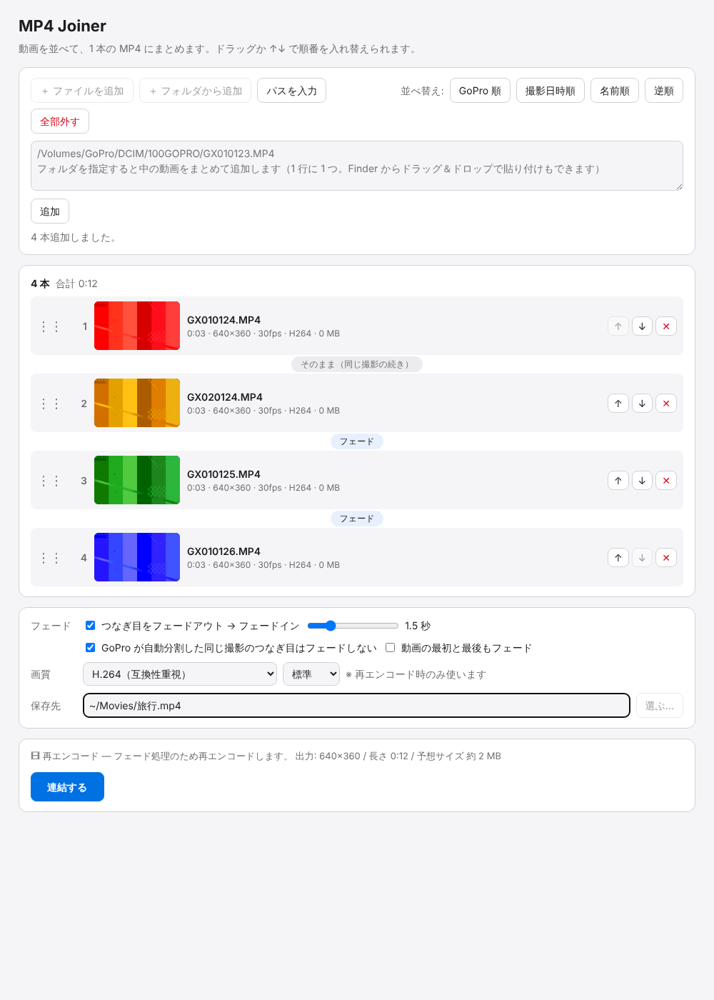

# MP4 Joiner（Mac 用）

GoPro などで撮った旅行動画（MP4）を、**順番を決めて 1 本にまとめる**だけのツール。
動画編集ソフトを立ち上げてタイムラインに並べて書き出す…という手間をなくすのが目的。

- 50 本程度までを想定（上限は設けていません）
- ドラッグ / ↑↓ ボタン / 「GoPro 順」「撮影日時順」「名前順」で並べ替え
- **フェードなしなら再エンコードしない高速コピー**（画質劣化なし、数十 GB でも数分）
- オプションで、つなぎ目を数秒かけて **フェードアウト → フェードイン**（映像・音声とも）
  - つなぎ目ごとにフェードする / しないを切り替え可能
  - GoPro が 4GB ごとに自動分割した「同じ撮影の続き」のつなぎ目は、既定でフェードしない
- 再エンコード時は Mac のハードウェアエンコーダ（VideoToolbox）を自動で使うので速い



## 必要なもの

- macOS（Apple Silicon / Intel どちらでも）
- Python 3（`xcode-select --install` で入る標準のもので OK。追加パッケージ不要）
- ffmpeg

```sh
brew install ffmpeg
```

## 使い方（画面で操作）

1. `MP4Joiner.command` を Finder でダブルクリック
   （初回は「開発元を確認できません」と出るので、右クリック →「開く」）
2. ブラウザに画面が開くので「＋ ファイルを追加」または「＋ フォルダから追加」で動画を選ぶ
   （GoPro の SD カードなら `DCIM/100GOPRO` フォルダを選ぶと全部入ります）
3. 「GoPro 順」を押す → 必要ならドラッグで微調整
4. フェードしたい場合は「つなぎ目をフェードアウト → フェードイン」にチェックして秒数を選ぶ
5. 保存先を選んで「連結する」

終わったら「Finder で表示」で出力ファイルを開けます。ツールを終了するときは、
起動したターミナルのウィンドウで `Ctrl + C`（またはウィンドウを閉じる）。

ターミナルから起動する場合:

```sh
cd mp4-joiner-mac
python3 -m mp4join
```

## 使い方（コマンドライン）

```sh
# フォルダ内を GoPro 順に並べて、そのまま高速連結
python3 -m mp4join join /Volumes/GoPro/DCIM/100GOPRO --sort gopro -o ~/Movies/旅行.mp4

# 指定した順番で、つなぎ目を 1.5 秒フェード（GoPro の分割の続きはフェードしない）
python3 -m mp4join join a.MP4 b.MP4 c.MP4 --fade 1.5 --keep-chapters -o ~/Movies/旅行.mp4

# 並び順と方式だけ確認
python3 -m mp4join join ~/Desktop/clips --sort date -o out.mp4 --dry-run
```

`python3 -m mp4join join --help` で全オプションを表示します。

## 連結の仕組み

| 条件 | 方式 | 速さ / 画質 |
| --- | --- | --- |
| フェードなし & 全クリップの解像度・fps・コーデック等が同じ | ffmpeg concat + `-c copy` | 非常に速い / 劣化なし |
| フェードあり、または形式が混在 | クリップごとに同じ設定で再エンコード → 最後に結合 | 動画の長さ相当の時間 / 「画質」設定に従う |

- 再エンコード時の解像度・fps は、クリップの中で一番多いものに揃えます（縦横比が違うものは黒帯）
- 音声のないクリップには無音を付けて、全体の音声トラックを揃えます
- HEVC で出力する場合は QuickTime / 写真.app で再生できるよう `hvc1` タグを付けます
- 中間ファイルは保存先と同じフォルダの隠しフォルダ（`.mp4join-…`）に作り、終了時に削除します
  （外付け SSD に保存すれば内蔵ディスクを圧迫しません）

### GoPro のファイル名と「GoPro 順」

GoPro は長い撮影を約 4GB ごとに分割し、`GX010123.MP4`, `GX020123.MP4` …（分割番号 + ファイル番号）
と名前を付けます。名前順に並べると分割番号が先に来て順番が崩れるので、「GoPro 順」は
**ファイル番号 → 分割番号** の順に並べます（旧形式の `GOPR0123.MP4` / `GP010123.MP4` にも対応）。

## 注意

- GoPro の GPS などのテレメトリ（GPMF）トラックは出力に含まれません（映像と音声のみ）
- 4K を再エンコードすると出力は元より小さくなります。画質を優先したい場合は「高画質」を選んでください
- 画面は `127.0.0.1` でのみ待ち受け、起動ごとに発行するトークンがないと操作できないようにしています

## 開発

```sh
python3 -m unittest discover -s tests   # ffmpeg で小さな動画を生成して実際に連結まで確認
```

```
mp4join/
  core.py           probe / 並べ替え / 連結プラン / ffmpeg 実行
  server.py         ブラウザ GUI 用のローカル HTTP サーバー（macOS ダイアログ連携）
  cli.py            コマンドライン
  static/index.html 画面
MP4Joiner.command   ダブルクリック起動用
```
